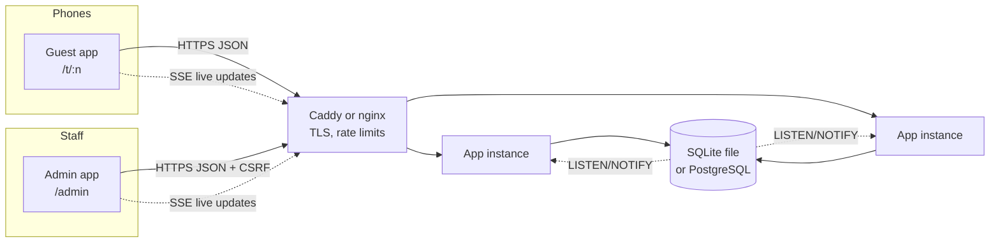
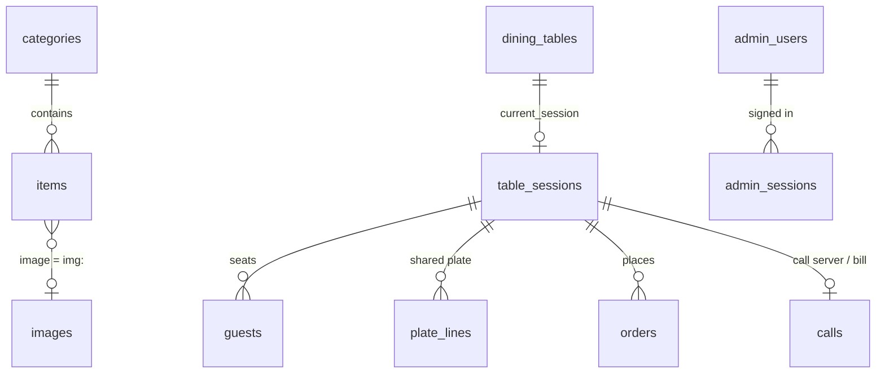
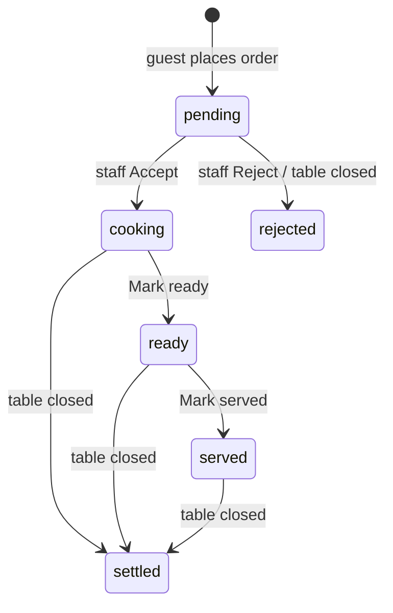

# Architecture

## Design goals

1. **The server is the source of truth.** Phones display; the server decides prices, totals, who is at which table, and which order changes are allowed.
2. **Simple to run.** One Node.js process and one SQLite file is a complete production install. No framework, no build step, no required npm packages.
3. **Scales by configuration, not rewrite.** Point `DATABASE_URL` at PostgreSQL and run as many instances as you like behind a load balancer.
4. **Feels instant.** Every action returns the new state immediately; everyone else at the table and in the kitchen gets a push within milliseconds.

## Components

| Layer | Files | Responsibility |
|---|---|---|
| Browser: guest | `web/index.html`, `web/js/guest.js` | Join flow, name reveal, 3D menu stage, plate, orders |
| Browser: admin | `web/admin.html`, `web/js/admin.js` | Sign-in, floor/orders board, menu/offers/staff editors |
| Shared logic | `web/js/shared/pricing.js`, `names.js` | Imported by **both** the browser and the server, so the bill preview and the charged amount are computed by identical code |
| HTTP | `server/http/*` | Router, cookies, JSON body limits, security headers, rate limiter, static files with brotli/gzip and ETags, SSE |
| Routes | `server/routes/api.js` | Input validation, authentication/authorisation, then a call into a service |
| Services | `server/services/auth.js`, `restaurant.js` | All business rules |
| Data | `server/db/*` | SQLite (built-in `node:sqlite`) or PostgreSQL (`pg`), shared SQL, migrations |
| Event bus | `server/bus/index.js` | In-memory for one instance; PostgreSQL `LISTEN/NOTIFY` across many |

## Request lifecycle

1. Request arrives. A request id is assigned, the client IP is derived (honouring `TRUST_PROXY` hops from the right of `X-Forwarded-For`), cookies are parsed, and security headers are set.
2. The router matches the path. API handlers then:
   - check identity (guest token or admin session) and, for writes, the CSRF token (admin) or the `x-hm` header (guest);
   - apply per-IP / per-session rate limits;
   - read the JSON body (64 KB cap) and validate it against a schema;
   - call the service.
3. The service reads/writes the database, often in a transaction, and publishes an event.
4. The response returns the new state (e.g. the full table snapshot after adding to the plate), so the acting phone updates without waiting for the push.
5. Errors become `{ "error": "<code>", "message": "<human sentence>" }` with the right status. Unexpected errors return a generic 500 with the request id; the stack trace only goes to the server log.

Non-API GET requests serve static files from `web/`. `/` and `/t/<n>` return `index.html`; `/admin` returns `admin.html`.

## Live updates (Server-Sent Events)

Each open guest phone holds one `GET /api/session/stream`; each admin screen holds one `GET /api/admin/stream`. These are ordinary long-lived HTTP responses (`text/event-stream`), which work through proxies, CDNs and load balancers, and the browser reconnects automatically.

Events carry **no private data**, only "something changed":

| Event | Sent to | Client then |
|---|---|---|
| `plate` | guests at that seating | re-fetches `/api/session` |
| `guests` | guests at that seating, admins | re-fetches |
| `orders` | guests at that seating, admins | re-fetches; admin chimes if `created` |
| `closed` | guests at that seating | shows "Thanks for eating with us" |
| `menu` | everyone | re-fetches the menu, rebuilds the stage |
| `floor` | admins | re-fetches `/api/admin/overview` |

Re-fetching through the normal, authorised endpoints means the event stream itself can never leak data to the wrong person, and a phone that missed events (sleeping, tunnel) simply re-syncs when it comes back (`visibilitychange` triggers a re-sync too). Fetches are debounced (120–250 ms) so a burst of changes costs one request.

**Across instances:** a service publishes to the bus. With PostgreSQL, the bus runs `SELECT pg_notify('hm_events', ...)`; every instance holds one connection that `LISTEN`s and forwards events to its own connected browsers. The menu cache on every instance is also invalidated through the bus.

A 20-second heartbeat comment keeps idle connections open through proxies.

## Data model

| Table | Purpose | Notes |
|---|---|---|
| `categories` | Menu sections | `sort`, `hidden`, `color` (the stage background) |
| `items` | Dishes | `price` in whole rupees; `ingredients` JSON; `image` is `img:<hash>` or `d:<drawn-id>`; `anim` spin/float/none; `available` (sold-out switch) |
| `images` | Uploaded photos | Stored in the database (BLOB/BYTEA), id = SHA-256 of the bytes. Served at `/img/<id>` with a one-year immutable cache. Identical uploads are stored once. |
| `settings` | Key/value | `offers` JSON |
| `dining_tables` | One row per table | `current_session` points at the live seating, or NULL when free |
| `table_sessions` | One row per seating | Random id, 4-digit `code`, `status` open/closed, timestamps |
| `guests` | People at a seating | Random id, funny `nick` (unique per seating), `emoji` |
| `plate_lines` | The shared plate | Primary key (session, item, guest): each person's quantity of each dish |
| `orders` | Placed orders | Snapshot of names, quantities and **server-computed** prices and totals; `status`; `idempotency_key` (unique) |
| `calls` | "Call server" / "Ask for the bill" | One per table |
| `admin_users`, `admin_sessions` | Staff accounts and sign-ins | scrypt password hashes; session tokens stored as SHA-256 hashes; per-session CSRF token |
| `login_attempts` | Lockout counters | Per username and per IP |
| `audit_log` | Every admin change | Who, what, when |
| `schema_migrations` | Applied migration versions | |

Timestamps are milliseconds since epoch (`BIGINT`). Money is integer rupees. All SQL is written once and runs on both SQLite and PostgreSQL; the PostgreSQL driver converts `?` placeholders to `$1..$n`.

### Why a seating ("table session") is the key idea

The QR code on a table is permanent and public. The **seating** is what grants access. Opening a table creates a seating with a random id and a fresh code; joining binds a guest to that seating with a signed cookie; every request re-checks that the seating is still the table's current one. Closing the table ends the seating, which instantly invalidates every cookie, link and code that belonged to it. The next group gets a new seating. That's how the shared plate is "reset" and how remote pranks are stopped (see SECURITY.md).

## Order lifecycle

Allowed moves are defined in `ORDER_FLOW` (`server/services/restaurant.js`). The update is a compare-and-set (`WHERE id = ? AND status = <old>`), so two staff tapping at once can't produce an invalid state; the slower tap gets "Someone else just updated this order".

### Placing an order (server side)

Inside one database transaction:

1. Confirm the seating is still current for the table.
2. Read every plate line for the seating and sum quantities per dish.
3. Refuse if empty, or if any dish is sold out (with the dish names).
4. Compute the bill with `priceBill()` using **current server prices and offers**.
5. Insert the order with a snapshot of names and prices; delete the plate lines.

Before the transaction: an `Idempotency-Key` header returns the existing order if the same request is retried (flaky mobile data), and a per-table cooldown (`ORDER_COOLDOWN_SECONDS`) blocks accidental double sends. A short lock in the browser stops two taps from the same phone.

## The 3D menu stage (browser)

- Every dish is a "card" absolutely positioned in a `perspective` container. Its position is a continuous float `f` (e.g. 2.37 = between dishes 2 and 3).
- Each frame, every card within ±2.6 of `f` gets one `transform` (translate3d, rotateY, scale) and an `opacity`. Nothing else changes per frame, so the browser composites on the GPU without layout or paint.
- Dragging maps finger movement to `f` with rubber-banding past the ends; release velocity is smoothed and projected to choose the target dish.
- Snapping uses a time-based, slightly under-damped spring (k = 190, damping 0.86 of critical). Time-based means it feels identical at 60 Hz and 120 Hz.
- Category backgrounds are stacked layers cross-faded with opacity. The info panel (name, ingredients, button) only rebuilds once the stage settles or after 170 ms on the same dish, never on every frame.
- `prefers-reduced-motion` turns off springs, spins and floats.

The end-to-end test measures frame intervals during a snap and fails if any frame takes 40 ms or more.

## Scaling notes

| Concern | One instance (SQLite) | Many instances (PostgreSQL) |
|---|---|---|
| Data | WAL mode, writes serialised in-process | Connection pool per instance (`PG_POOL_MAX`) |
| Live updates | In-memory event emitter | `LISTEN/NOTIFY` |
| Menu cache | In memory, cleared on change | Cleared on every instance via the bus |
| Rate limits | Per instance | nginx limits cluster-wide + per instance |
| Sessions | Database | Database (no sticky sessions) |
| Photos | Database | Database (no shared disk) |
| Migrations | Transaction | Transaction + advisory lock |

Rough capacity: a single 1 vCPU instance handles hundreds of concurrent phones; each SSE connection costs a few KB of memory. The menu (≈8 KB JSON) and photos are cached by browsers (ETag / immutable).
